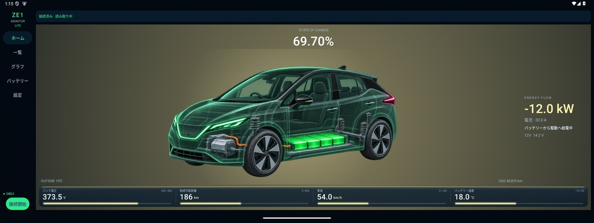

# ZE1 Monitor Lite

The **lightweight edition** of ZE1 Monitor, a vehicle monitor app (Android) for the 2nd-generation Nissan Leaf (ZE1, model years 2017–2025).
**This is an unofficial app made by an individual. It is not affiliated with Nissan.**

It runs on **Android 5.0 or later**, for devices that cannot install the full edition (Android 8.0+) or old tablets where it feels heavy.
On devices that run Android 8.0+ comfortably, the [full edition](https://github.com/kojipa/ze1monitor-releases) is recommended.
The app screens are in Japanese only.

[日本語](README.md)

## Download

Download `ze1monitor-lite-0.1.1.apk` from [Releases](https://github.com/kojipa/ze1monitor-lite-releases/releases).

## Features

- **Home**: actual SOC, power (including regen), current, 12 V battery, pack voltage, range, speed, battery temperature, outside temperature, odometer. The state (charging, driving, regen, standby) is shown by colour. The actual SOC is not the meter % (about 95% when full).
- **List**: SOH (read on connecting) and the latest value of each item.
- **Last 15 minutes graph** of the chosen item.
- **Battery** (while parked): cell spread diagnosis over the 96 cells, 12 V battery voltage, estimated 100% capacity, cell voltages, battery temperatures per sensor. Results are kept only on this device.
- Auto-connect, connection failure reasons, text size, keep screen on.
- Portrait and landscape. The app is about 450 KB.

## Differences from the full edition

| | Full | Lite |
|---|---|---|
| Android | 8.0+ | **5.0+** |
| Home | Animated | Still image + colour (light) |
| OBD2 adapter | Bluetooth, BLE, Wi-Fi | **Bluetooth (classic) only** |
| Trips, eco-driving challenge, driving/charging records | Yes | No |
| Demo mode, English | Yes | No |

The two are separate apps and can be installed side by side.

## Requirements

- A phone, tablet or car head unit with Android 5.0 or later
- An **ELM327-compatible** OBD2 adapter over **Bluetooth (classic / SPP)**, paired in Android's Bluetooth settings first (PIN is usually `1234` or `0000`). BLE-only and Wi-Fi adapters are not supported.

## Not yet tested on a real car

This version (lite-0.1.1) has not yet been run on a real car. It reads the values the same way as the full edition, whose formulas were checked against real logs (2018, 40 kWh).
Not yet checked: running on a real car (update speed, long connections), Android 5–7 devices, quick charging, the 62 kWh (e+), other model years and grades.

Please send what you notice through the [report form](https://docs.google.com/forms/d/e/1FAIpQLSclf5l6DPGDX64-3JDfNzAvxoqTRNH3-xf9LgrAWVtxSSxtJA/viewform).

## Safety and disclaimer

- The app sends read commands only. It never sends commands that change the car's settings, resets or clears trouble codes.
- The internet is used only for the update check (at most once a day, can be turned off). No vehicle data leaves the device.
- Values are estimates and their accuracy is not guaranteed. The author is not liable for any damage from using this app or an OBD2 adapter. Use at your own risk.
- **Do not operate the app while driving.** An adapter left plugged in can drain the 12 V battery.

## References

- [OVMS v3](https://github.com/openvehicles/Open-Vehicle-Monitoring-System-3) (vehicle_nissanleaf, MIT License)
- [zerinrc/ze1tcu](https://github.com/zerinrc/ze1tcu) (MIT License)
- [dalathegreat/leaf_can_bus_messages](https://github.com/dalathegreat/leaf_can_bus_messages) (Nissan Leaf 2018 ECU polling)
