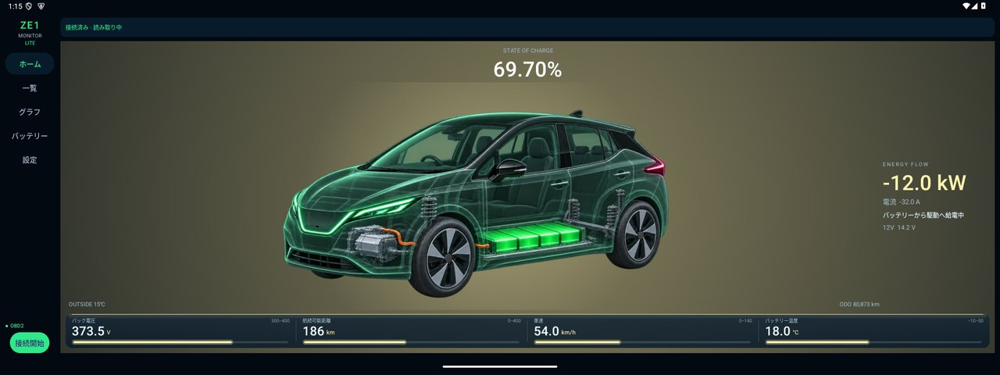
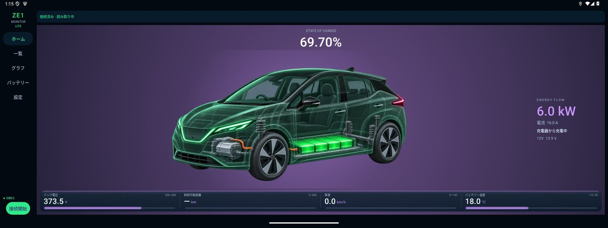
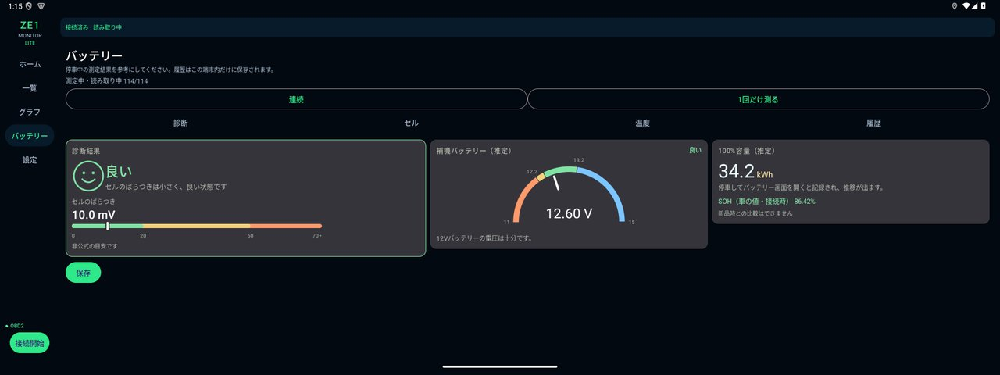
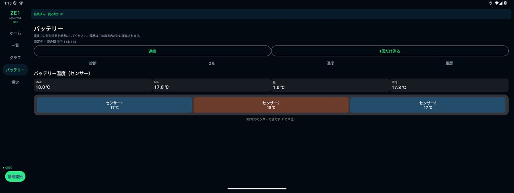

# ZE1 Monitor Lite（軽量版）

2代目日産リーフ（ZE1、2017〜2025年式）用の車両モニターアプリ「ZE1 Monitor」の **軽量版**（Android）です。
**個人が作った非公式のアプリです。日産自動車とは関係ありません。**

**Android 5.0 以上** で動きます。通常版（Android 8.0 以上）が入らない端末や、通常版が重く感じる古いタブレットなど向けです。
Android 8.0 以上で快適に動く端末なら、[通常版](https://github.com/kojipa/ze1monitor-releases) がおすすめです。

[English](README.en.md)

## ダウンロード

[Releases](https://github.com/kojipa/ze1monitor-lite-releases/releases) から `ze1monitor-lite-0.1.2.apk` をダウンロードしてください。

## できること

- **ホーム**：実SOC、出力（回生を含む）、電流、12Vバッテリー、パック電圧、航続可能距離、車速、電池温度、外気温、走行距離、ECO・e-Pedal の ON/OFF。状態（充電中・走行中・回生・待機）は色の変化で表します。実SOC はメーターの%とは別の値で、満充電のときで約95%です。
- **一覧**：SOH（接続時）と、各項目の最新の値を並べて表示します。
- **直近15分のグラフ**：選んだ項目の変化を表示します。
- **バッテリー**：停車中に、セル96本のばらつきの診断、12Vバッテリーの電圧、100%容量の目安、セルの電圧、電池温度（センサーごと）を表示します。結果はこの端末の中にだけ履歴として残ります。
- **自動接続**、つながらないときの理由表示、文字の大きさ（小・標準・大・特大）、画面を消さない設定
- 画面は縦向き・横向きのどちらでも使えます。アプリのサイズは約450KBです。

## 通常版との違い

| | 通常版 | Lite版 |
|---|---|---|
| 対応Android | 8.0以上 | **5.0以上** |
| ホームの演出 | 光が流れるアニメーション | 静止画＋色の変化（軽い） |
| OBD2アダプター | Bluetooth、BLE、Wi-Fi | **Bluetooth（クラシック）のみ** |
| トリップ・エコ運転チャレンジ・走行と充電の記録 | あり | なし |
| デモモード・英語表示 | あり | なし |
| バッテリー画面 | あり | あり（簡単なもの） |

通常版とLite版は別のアプリなので、同じ端末に両方入れることもできます。

## 必要なもの

- Android 5.0 以上のスマートフォン、タブレット、カーナビ（Android）
- **Bluetooth（クラシック／SPP）** 接続の **ELM327 互換** OBD2 アダプター
  - BLE 専用のアダプターや、Wi-Fi 接続のアダプターには対応していません。
  - 先に Android の「設定」→「Bluetooth」でペアリングしておいてください（PIN はたいてい `1234` か `0000` です）。

## 入れ方

1. 端末のブラウザで、Releases から APK をダウンロードします。
2. ダウンロードしたファイルを開きます。
3. 提供元不明のアプリのインストールを許可します。
   - **Android 8.0 以上**：「この提供元のアプリを許可しますか」と出たら許可して戻ります。
   - **Android 5〜7**：「設定」→「セキュリティ」→「提供元不明のアプリ」をオンにします。
4. Google Play プロテクトの警告が出たら、「詳細」→「このままインストール」で進めてください。

## 使い方

1. 車の電源を入れて、OBD2 アダプターを差し込みます。
2. アプリを起動し、注意書きを読んで「同意して開始」を押します。
3. 「設定」の **Bluetooth接続先** で、ペアリング済みのアダプターを選びます。
4. 「接続開始」を押すと、数秒〜十数秒でホームに値が表示されます。

## 実車で試していないこと

この版（lite-0.1.2）は、まだ実車で動かしていない試験版です。値の読み方は通常版と同じで、実車の記録（2018年式 40kWh）で計算が合うことを確かめています。
次のことは、まだ実車で確かめていません。

- このアプリを実車につないで動かすこと（表示の更新の速さ、長時間の接続を含む）
- Android 5〜7 の端末での動作
- 急速充電中の表示、62kWh（e+）の車、2018年式 40kWh 以外の年式・グレード

気づいたことは、[報告フォーム](https://docs.google.com/forms/d/e/1FAIpQLSclf5l6DPGDX64-3JDfNzAvxoqTRNH3-xf9LgrAWVtxSSxtJA/viewform) から送ってください（端末名と Android のバージョンも教えてください）。

## 安全について

- 車に送るのは読み取りの命令だけです。車の設定を変える命令、リセット、故障コードの消去などは機能として入っていません。
- インターネットは更新確認にだけ使います（1日1回まで、設定でオフにできます）。車両のデータを外部に送ることはありません。位置情報も使いません。

## 免責事項

- このアプリは個人が作った非公式のものです。日産自動車および関係会社とは一切関係ありません。
- 表示される値は車から読み取った値をもとにした目安で、正確さは保証しません。車の状態の判断は、車のメーターと販売店の点検を優先してください。
- このアプリや OBD2 アダプターの使用によって生じたいかなる損害（車両の故障、バッテリー上がり、事故など）についても、作者は責任を負いません。自己責任でご利用ください。
- **運転中は画面を操作しないでください。**
- OBD2 アダプターを挿したままにすると、12V バッテリーが減ることがあります。使わないときは抜いてください。

## 参考にした資料

車からの値の読み方は、次の公開資料を参考にしました（コードの複製はしていません）。

- [OVMS v3](https://github.com/openvehicles/Open-Vehicle-Monitoring-System-3)（vehicle_nissanleaf、MIT License）
- [zerinrc/ze1tcu](https://github.com/zerinrc/ze1tcu)（MIT License）
- [dalathegreat/leaf_can_bus_messages](https://github.com/dalathegreat/leaf_can_bus_messages)（Nissan Leaf 2018 ECU polling）
